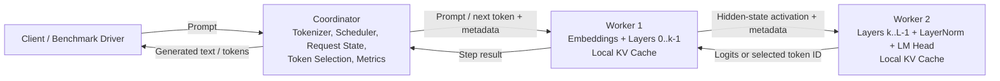
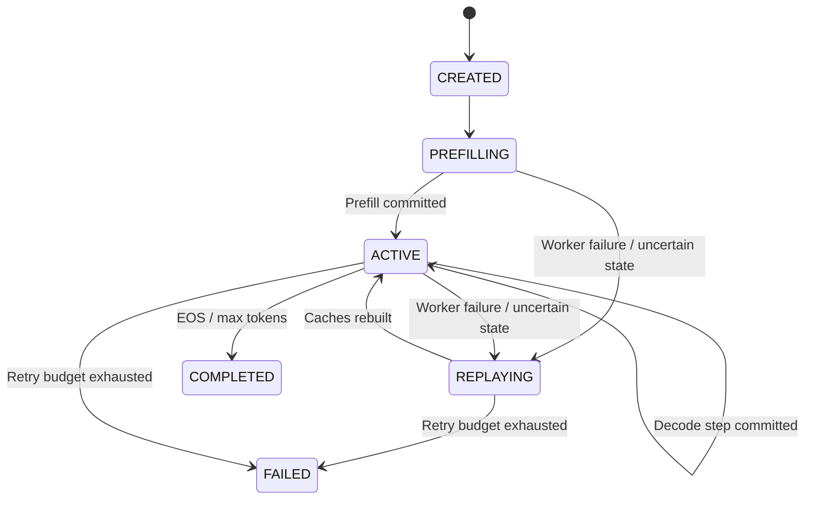

# Parallel LLM Inference

A two-worker pipeline-parallel inference serving engine for small pretrained decoder-only language models, focused on inter-process activation transfer, per-request KV-cache isolation, concurrent scheduling, backpressure, and fault recovery.

## Research Question

> **How effectively can a two-stage distributed inference pipeline improve aggregate LLM serving throughput under concurrent workloads, and what are the resulting costs in latency, communication, resource utilization, and fault recovery?**

Key questions this project investigates:
- Does partitioning a small causal LM across two processes improve throughput over single-process inference, and how does that change with concurrency?
- How should Transformer layers be balanced between Worker 1 (embeddings + early layers) and Worker 2 (remaining layers + layer norm + LM head)?
- How much overhead comes from activation serialization vs. returning full vocabulary logits?
- How can concurrent requests overlap across stages without corrupting KV caches or emitting duplicate/out-of-order tokens under worker failures?

## System Architecture

The system consists of a **Coordinator** and two independent **Worker** processes communicating over gRPC/TCP. Worker 1 streams hidden-state activations directly to Worker 2 rather than relaying intermediate tensors back through the coordinator.



| Component | Responsibilities |
| --- | --- |
| **Coordinator** | Request IDs, tokenization, admission control, request state machine, token commits, gRPC deadlines, retries, metrics |
| **Worker 1** | Token & position embeddings, initial Transformer layers, local KV cache, activation serialization, direct RPC to Worker 2 |
| **Worker 2** | Remaining Transformer layers, local KV cache, final layer norm, LM head projection, logits or greedy next-token selection |

## Model & Partitioning

- **Default checkpoint**: `distilbert/distilgpt2` (88.2M parameters, 6 Transformer layers, hidden size 768, 12 attention heads, vocab size 50,257, max context 1,024 tokens, FP32 baseline).
- **Layer splits**: Starts with a `3 + 3` split and evaluates `2 + 4` and `4 + 2` to account for embedding overhead on Worker 1 and LM-head projection overhead on Worker 2.
- **Custom model adapter**: Encapsulates `prefill`, `decode`, `reset`, and `clear` behind a clean `ModelPartition` interface instead of `model.generate()`, with explicit handling for tied input/output embedding weights across separate processes.
- **Token-selection modes**:
  - **Mode A (Coordinator-side)**: Worker 2 returns full vocabulary logits (~196 KiB in FP32 per step) and the coordinator runs greedy `argmax`.
  - **Mode B (Worker-side)**: Worker 2 computes greedy `argmax` locally and returns only the selected token ID, reducing return payload size dramatically compared to single-token activations (~3 KiB in FP32).

## Concurrency, Caching & Flow Control

- **Iteration-level pipelining**: Independent requests interleave across Worker 1 and Worker 2 so Worker 1 can process Request B while Worker 2 finishes Request A.
- **AsyncIO + non-blocking execution**: Workers run gRPC AsyncIO servers with bounded `asyncio.Queue` instances and offload blocking PyTorch forward passes outside the event loop.
- **Per-request KV-cache isolation**: Each worker stores KV-cache state only for its own layers, keyed by `(request_id, attempt_id)`, with explicit cleanup on request completion or terminal failure.
- **Bounded queues & backpressure**: Explicit queue limits at both workers and admission control at the coordinator prevent unbounded memory growth and return explicit overload responses when saturated.

## Fault Tolerance & Recovery

Rather than claiming exactly-once RPC execution, the system provides **at-least-once RPC execution with idempotent worker handling and exactly-once token commitment at the coordinator**.

Every RPC carries four identifiers:
- `request_id` — unique inference request identifier
- `attempt_id` — current execution/replay attempt
- `step_id` — prefill or decode step index
- `worker_epoch` — active worker incarnation for stale-response fencing



On worker failure or timeout:
1. Stop accepting responses from the affected epoch and restart the failed worker with an incremented `worker_epoch`.
2. Increment `attempt_id` for affected active requests and reset their KV caches on **both** workers to guarantee consistency.
3. Replay the prompt plus all committed generated tokens through the pipeline (suppressing replay outputs) to rebuild both caches.
4. Resume decoding from the next uncommitted step, or fail the request explicitly if the retry budget is exhausted.

## Implementation Roadmap

| Phase | Milestone | Completion Condition |
| --- | --- | --- |
| **Phase 0** | Environment, hardware check, checkpoint verification | Standalone inference works |
| **Phase 1** | Single-process reference baseline with deterministic greedy decoding | Reproducible baseline tokens, logits, and timings |
| **Phase 2** | In-process two-partition model + independent KV caches (no RPC) | Partitioned outputs match reference baseline |
| **Phase 3** | Protobuf schema, tensor codec, independent gRPC workers, deadlines | End-to-end inference over gRPC |
| **Phase 4** | AsyncIO coordinator, bounded queues, backpressure, concurrent requests | Concurrency (1, 2, 4) without cache corruption |
| **Phase 5** | Epoch fencing, deduplication, worker kill/restart, history replay | Clean recovery under injected failures |
| **Phase 6** | Layer-split sweeps, Mode A vs. B, optional micro-batching, multi-node eval | Reproducible CSV metrics and plots |

## Evaluation Plan

Four configurations isolate partitioning, serialization, and network overhead:
- **E1**: Single-process reference model
- **E2**: Two model partitions in one process (splitting overhead)
- **E3**: Two gRPC workers on the same host over loopback TCP (RPC & serialization overhead)
- **E4**: Two gRPC workers on separate hosts (real network overhead)

**Benchmark matrix**: Concurrency `{1, 2, 4}` · Prompt lengths `{16, 32, 64}` · Generated tokens `{16, 32}` · Layer splits `{2+4, 3+3, 4+2}` · FP32 (plus FP16 where supported).

**Tracked metrics**: TTFT, TPOT, p50/p95 latency, aggregate tokens/sec, requests/sec, queue wait time, per-stage execution time, activation vs. control/logits bytes, recovery time, and exact token agreement vs. baseline.

## Repository Structure

```text
parallel-llm-inference/
├── coordinator/           # Coordinator service, scheduler, request & recovery managers, metrics
├── workers/               # Independent Worker 1 and Worker 2 gRPC services
├── model/                 # Reference model, partition adapter, checkpoint splitter, KV-cache manager
├── proto/                 # Protocol Buffer definitions and generated stubs
├── common/                # Config loader, tensor codec, request/epoch identifiers, logging
├── tests/                 # Parity, KV-cache, concurrency, ordering, backpressure, recovery tests
├── experiments/           # Benchmark runners, failure tests, CSV metric collectors, plotting
├── scripts/               # Worker start/stop and fault-injection scripts
├── results/               # Raw CSV outputs and generated plots (gitignored)
├── config.yaml            # Default model, partitioning, queue, and timeout settings
├── requirements.txt
└── README.md
```

## Tech Stack

- **Language & Concurrency**: Python 3.11+, `asyncio`
- **Model Execution**: PyTorch, Hugging Face `transformers`
- **RPC & Serialization**: gRPC (`grpcio`, `grpcio-tools`), Protocol Buffers
- **Metrics, Plotting & Testing**: NumPy, pandas, Matplotlib, `pytest`, PyYAML

## Getting Started

```bash
python3 -m venv .venv
source .venv/bin/activate
pip install -r requirements.txt
```

## Contributors

- **Rajath Gadagkar** — [rajathgadagkar@gmail.com](mailto:rajathgadagkar@gmail.com)
- **Sai Kiran** — [skn054@gmail.com](mailto:skn054@gmail.com)
